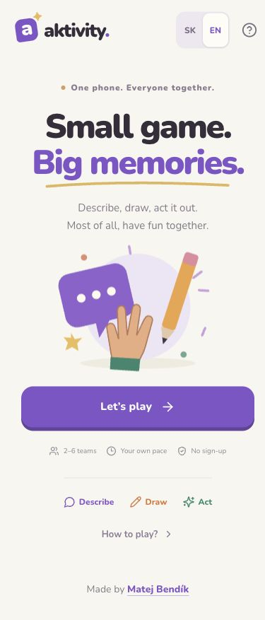
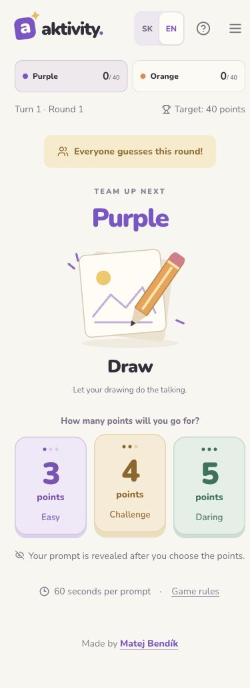
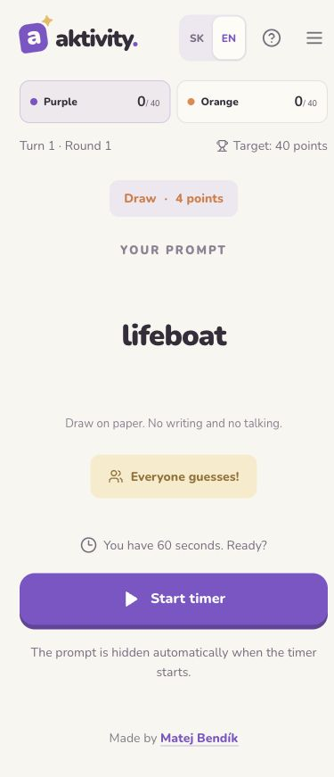

# Aktivity

A mobile-first party game for **2–6 teams sharing one phone**, available in **English and Slovak**. Describe a word, draw on paper, or act it out. Choose prompts worth **3, 4, or 5 points**, with occasional open rounds where everyone can guess. The prompt collection is intended for adults (**18+**).

Built with Next.js, TypeScript, Tailwind CSS, Zustand, React Hook Form, Zod, and i18next. No accounts, online rooms, or registration required.

## Screenshots

Actual mobile screenshots of the English interface:

|                                                          Home                                                           |                                                               Choose your challenge                                                               |                                                          Reveal your prompt                                                           |
| :---------------------------------------------------------------------------------------------------------------------: | :-----------------------------------------------------------------------------------------------------------------------------------------------: | :-----------------------------------------------------------------------------------------------------------------------------------: |
|  |  |  |

## Local development

Requirements: **Bun 1.2.22 or later** and **Node.js 20.9 or later**.

```sh
bun install
bun run dev
```

Open [localhost:3000](http://localhost:3000). To use a different port:

```sh
bun run dev --port 3001
```

## Checks and production builds

```sh
bun test
bun run typecheck
bun run lint
bun run build
bun run start
```

The app uses Next.js 16 App Router, Tailwind CSS 4 through its official PostCSS plugin, and locally bundled Nunito fonts. `bun.lock` is the only package lockfile. No application environment variables or external services are required.

### Deploying to Vercel

Import this GitHub repository and select **Next.js** as the framework. Use `bun install --frozen-lockfile` as the install command and `bun run build` as the build command. Keep the repository root as the project root and leave Output Directory at its framework default.

Setup references: [Next.js](https://nextjs.org/docs/app/getting-started/installation), [Tailwind CSS with Next.js](https://tailwindcss.com/docs/installation/framework-guides/nextjs), and [Bun with Next.js](https://bun.sh/guides/ecosystem/nextjs).

## How to play

- **Teams and settings:** create 2–6 teams with custom names and colors, or use the Men vs women preset. Defaults are 60 seconds per turn, a target of 40 points, and open rounds enabled.
- **Activities:** describe without using the prompt's word stem or a translation; draw on paper without writing or talking; or act without words or sounds. Have a pen and paper ready.
- **Fair rotation:** activities are planned three rounds ahead. In each planned block, every team gets Describe, Draw, and Act once. An activity cannot repeat either the team's own previous activity or the activity of the immediately preceding team. These rules also apply across round and block boundaries. Success, failure, and point value do not determine the next activity. With two teams, these constraints force a regular sequence after the opening activities.
- **Choose a difficulty:** select 3, 4, or 5 points before privately revealing the prompt. The difficulty cannot change after selection, and there is no replacement prompt within a turn.
- **Start explicitly:** revealing the prompt does not start the timer. Starting the timer automatically hides the prompt; use **Show prompt** to view it again. The green check on the right confirms a correct guess; the red X on the left ends the turn without points.
- **Confirm in time:** a successful answer must be confirmed **before** the absolute deadline. A click exactly at the deadline is too late. Expired turns automatically receive zero points, with no option to award points afterward.
- **Open rounds:** when “Everyone guesses” is enabled, eligible turns have a 20% chance of becoming open rounds; two open rounds never occur consecutively. A timely green check records success and stops the countdown. The winning team can then be selected, even after the original deadline. It earns the prompt's points; if an opponent guesses, the performing team also earns 2 points.
- **Sound cues:** a short chime announces an open round as soon as its banner appears. It does not repeat when the timer starts or the page reloads. **Game sounds** controls the chime, the final five countdown ticks, and the time-up signal. All cues use doubled signal gain (+6 dB); phone media volume remains adjustable normally.
- **Correct a result:** an accidentally confirmed success can be revoked on the result screen, removing both the prompt points and any bonus. A failed turn cannot later become a success.
- **Win:** victory is checked after all points from a turn have been awarded. Once the target is reached, the highest score wins. Teams tied for the highest score at or above the target share the victory. Teams manage their own performer rotation.

## Saving and restoring games

A provider-local Zustand store uses `persist`, explicit hydration after mounting, and selectors. Each game change is synchronously saved to `localStorage` before the updated state is rendered. Saved data includes teams, turn order, scores, activity, prompt, used words, results, phase, prompt visibility, the activity queue, and the absolute timer deadline.

`aktivity.store.v1` stores the game and unfinished setup form. `aktivity.store.v1.backup` is its synchronous backup. The original `aktivity.game.v1`, its backup, and `aktivity.setup.v1` are imported on first load when no newer save exists; the original records are left untouched. A damaged newer save is restored from its newer backup, never silently replaced with stale legacy scores.

The **game state format is version 2**, while the Zustand envelope version and storage keys remain unchanged. `activityQueue` holds the remaining activities in the prepared block. The first activity is assigned when a game starts; subsequent activities are consumed only when advancing to the next team. Each team's latest activity is derived from the performing team in the history, not the winning team of an open round. Every new block respects that history and the current turn. A rematch creates a fresh schedule.

Version 1 games retain their current prompt and timer during migration. Their old `bag` is discarded, and a new block is planned only for the next team. The first new block after migration can therefore start partway through a round.

Refreshing or returning to the app restores the last game automatically. Internal screen changes do not create new URLs or browser history entries. Closing the page or navigating away does not erase the game. If the deadline passes while the app is closed or in the background, the turn is resolved as unsuccessful on return. Opening the menu or switching apps does not pause the timer.

Storage belongs to a specific browser and origin. Clearing site data or a private browsing session can remove the game. The app displays a warning when storage is unavailable. An active game is replaced only when a new game actually starts, not when the setup screen opens.

## Project structure

| Location                   | Responsibility                                                                                                                                       |
| -------------------------- | ---------------------------------------------------------------------------------------------------------------------------------------------------- |
| `lib/activity-schedule.ts` | Three-round activity planning with randomized candidate order and backtracking; rotation constraints are never relaxed.                              |
| `lib/game.ts`              | Game types, pure state transitions, save validation, migration, and scoring.                                                                         |
| `lib/words.ts`             | 450 original Slovak prompts: exactly 50 per activity and point value.                                                                                |
| `lib/setup.ts`             | Shared Zod schemas for unfinished drafts and submitted setup forms.                                                                                  |
| `lib/sound.ts`             | Synthesized sound cues and final-five-second countdown timing.                                                                                       |
| `stores/`                  | Zustand store, SSR-safe provider, validated persistence, and legacy storage import.                                                                  |
| `components/screens/`      | Home and setup screens; React Hook Form, Zod resolver, `useFieldArray`, `Controller`, and draft subscriptions.                                       |
| `components/game/`         | Separate screens for each phase of a turn and the final results.                                                                                     |
| `components/ui/`           | Reusable buttons, switches, segmented controls, validation errors, and game notices. Tailwind classes are composed with `clsx` and `tailwind-merge`. |
| `hooks/`                   | Timer/audio runtime and local countdown rendering without storage writes on every tick.                                                              |
| `i18n/`                    | English and Slovak UI resources, English prompts, and language selection.                                                                            |
| `app/globals.css`          | Tailwind entry point, theme, and animations; no custom UI selectors.                                                                                 |
| `tests/`                   | Rules, scheduling, timing, sound, content, validation, migration, backups, SSR isolation, localization, and restoration.                             |
| `docs/screenshots/`        | Mobile screenshots embedded in this README.                                                                                                          |

Prompt difficulty is an editorial estimate, assessed independently for each activity. Automated tests verify pool sizes, uniqueness within pools, and prevention of repeated normalized prompt text during a game. Further difficulty tuning benefits from playtesting with real groups.

Architecture references: [Zustand with Next.js](https://zustand.docs.pmnd.rs/learn/guides/nextjs), [Zustand persist](https://zustand.docs.pmnd.rs/reference/middlewares/persist), [React Hook Form Zod resolver](https://github.com/react-hook-form/resolvers#zod), and [Zod](https://zod.dev/).

## Languages and translations

**English is the default.** The **SK / EN** switch in the navigation immediately translates the full interface and the current prompt. The language preference is stored separately under `aktivity.language.v1` and restored on page load. Switching languages does not redraw a prompt or change scores, turn order, history, or the absolute timer deadline. Custom team names are preserved; built-in names, the Men/Women preset, and numbered teams are localized.

- `i18n/instance.ts` creates a separate i18next instance for each provider, preventing language state from leaking between SSR requests.
- `i18n/provider.tsx` manages the React provider, saved preference, document language, and metadata.
- `i18n/locales/{sk,en}.json` contains complete UI catalogs, including rules, validation messages, storage errors, and Slovak plural forms.
- `i18n/words-en.ts` contains English translations of all 450 prompts in the same order as the original Slovak pools. When adding or moving a prompt, update the matching entry in both files.
- `i18n/resources.ts` maps translations to the original normalized text. IDs and saved Slovak prompts remain stable, so switching languages does not change the no-repeat rules.
- `tests/i18n.test.tsx` checks translation coverage, interpolation, plurals, rendering of all game screens in both languages, and preservation of game state when switching languages.

Translations are bundled with the app and require no API or network fetch. The **aktivity.** brand stays the same in both languages. Documentation: [i18next](https://www.i18next.com/) and [react-i18next](https://react.i18next.com/latest/using-with-hooks).
